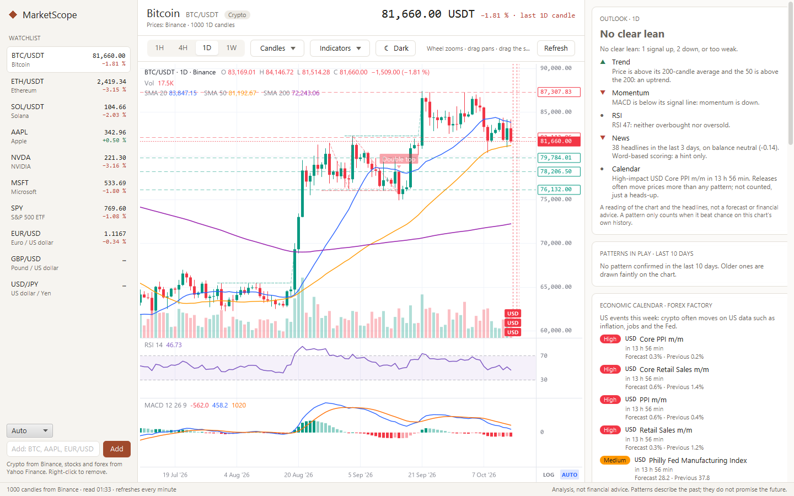
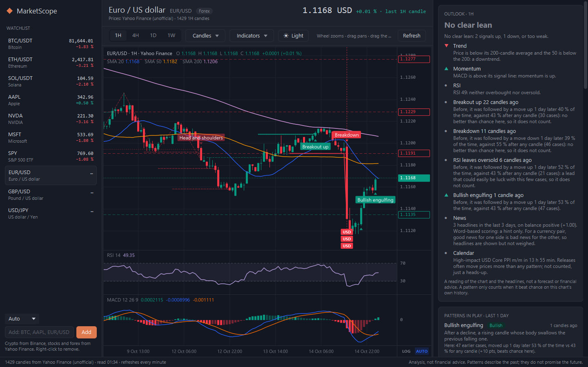
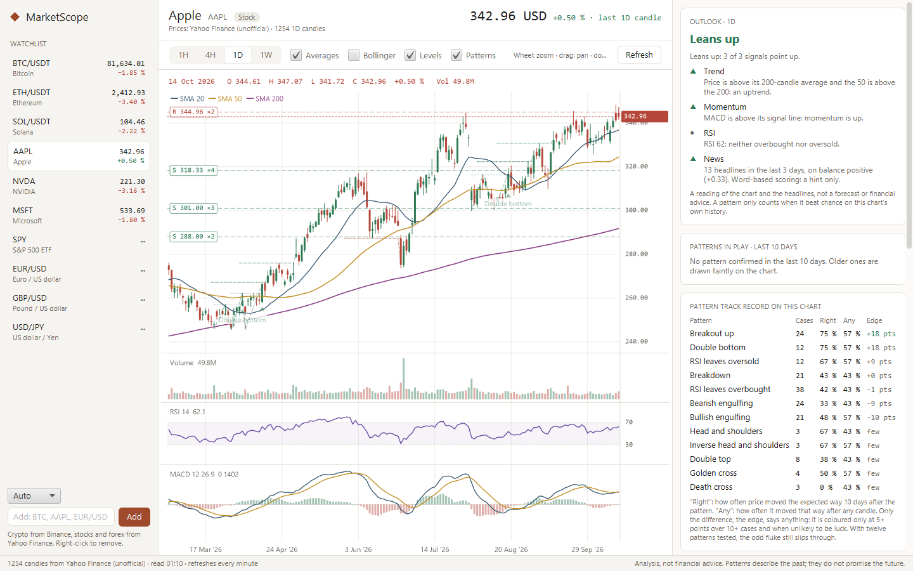
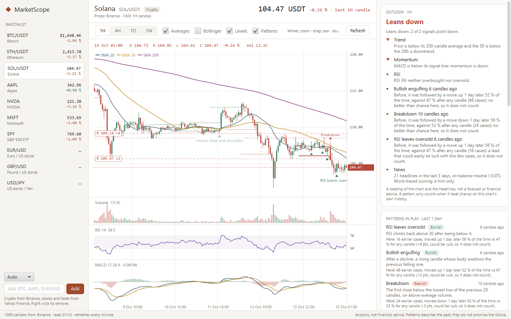

# MarketScope

MarketScope is a Windows desktop app for reading crypto, stock and forex charts. For any asset it:

- draws a **TradingView-style chart**: candles, bars, line, area or Heikin-Ashi, with volume under
  the price, moving averages (20, 50, 200), Bollinger bands, RSI and MACD, in 1-hour, 4-hour, daily
  or weekly candles, in a light or a dark theme;
- marks **support and resistance**: prices where recent swings keep turning;
- finds **classic patterns**: double tops and bottoms, head and shoulders (and inverse),
  breakouts and breakdowns, golden and death crosses, RSI leaving overbought or oversold,
  bullish and bearish engulfing candles;
- checks **how each pattern actually played out on that asset's own history**, against how often
  price moved that way anyway;
- shows this week's **economic calendar from Forex Factory** for the currencies that matter
  (high-impact releases are flagged on the chart, and a warning appears when one is near);
- reads the **latest headlines** and scores their tone;
- sums it all up as an **outlook**: leans up, leans down, or no clear lean, with every reason
  shown.

It is a sibling of TerraScope: same Java 25 / JavaFX 25 stack, same warm, light look.

> **Analysis, not financial advice.** MarketScope describes what a chart and the headlines look
> like today and how similar setups went before on the same chart. It does not predict prices,
> does not tell anyone to buy or sell, and never places orders. Past patterns do not promise
> future moves.

## Screenshots

Live data, 15 October 2026.

| | |
|---|---|
|  Bitcoin, daily, light theme |  EUR/USD, hourly, dark theme |
|  Apple, daily |  Solana, hourly |

## How "prediction" works here, honestly

Chart patterns and headline tone are weak signals; if they reliably predicted prices, prices would
already reflect them. So MarketScope never trusts a pattern because of its name. It **scores every
pattern on the asset's own history first**:

1. Every pattern is found the way it would have been seen live. A pattern only counts from the
   candle at which it was *confirmed* (the neckline break, the close above the range), and the
   finder never looks at later candles. A test proves it: running the finder on the history up to
   any candle gives exactly the patterns the full history has up to that candle.
2. For every past occurrence, MarketScope checks whether the price moved the expected way a fixed
   time later (1 day for 1H candles, 2 days for 4H, 10 days for daily, 4 weeks for weekly).
3. It compares that hit rate with the **base rate**: how often the price moved that way after
   *any* candle. "Right 56 % of the time" means nothing if price rose 56 % of the time anyway; only
   the difference, the **edge**, says anything.
4. A pattern only counts towards the outlook when it has **10 or more cases, an edge of 5 points or
   more, and an edge unlikely to be luck** (at least 1.28 standard errors). Twelve patterns are
   tested on every chart, so the odd fluke still gets through; the app says so.

On most charts most patterns turn out to be no better than chance. That is the honest result, and
the app shows it, for example "Breakout up: 56 % vs 53 % for any candle, +3 pts, could be luck".

The **outlook** adds up a few simple readings: the trend (price and the 50- against the
200-candle average), momentum (MACD against its signal line), RSI (stretched above 70 or below
30), recent patterns that beat chance, and the tone of the last three days of headlines. The
headlines count for less than the chart and not at all for currency pairs, because good news for
one currency is bad news for the other side of the pair. The result leans one way only when the
readings agree.

**Headline sentiment** is a small, offline word list ("surge", "rally", "upgrade" against
"plunge", "hack", "lawsuit", with negations such as "fails to rally" flipped). It reads words, not
meaning, and is shown as a hint.

## The chart

It works like TradingView's:

- **Mouse wheel** zooms around the mouse; **dragging** the chart pans it (dragging it up or down too
  switches the price scale to manual). **Drag the price scale** to stretch it, **drag the time
  scale** to zoom. A **double-click** on the price scale returns to automatic scaling, anywhere
  else to the latest candles. **LOG** and **AUTO** under the price scale switch a logarithmic scale
  and automatic scaling; the **»** button jumps back to the latest candle.
- The legend at the top left reads out the candle under the crosshair (open, high, low, close,
  change, volume) and the indicator values; the crosshair puts its price and time on the scales.
- **Chart type**: candles, bars, line, area or Heikin-Ashi (average bars; the analysis always uses
  the real candles). **Indicators**: volume, moving averages, Bollinger bands, RSI, MACD, support
  and resistance, patterns and economic events, each switched on or off.
- **Dark / Light** switches TradingView's dark and light looks. The chart type, indicators, theme
  and log scale are remembered in `settings.json` next to the watchlist.

## Economic calendar (Forex Factory)

The calendar comes from Forex Factory's own weekly export (`nfs.faireconomy.media`), read at most
once an hour and kept on disk, so MarketScope does not hammer it. For a currency pair it shows both
currencies' events; for stocks and crypto the US ones (crypto often moves on US inflation, jobs and
Fed data). High-impact releases get a flag on the chart's time axis, also ahead of the last candle,
with a dashed line; hover a flag for the forecast and the previous figure. The side panel lists the
week's high- and medium-impact events, and a warning appears at the top when a high-impact release
is due within 12 hours. The outlook mentions one due within a day: releases often move prices more
than any pattern.

Forex Factory has no news feed, only its web page, and MarketScope does not scrape it; the
**Forex Factory news** button opens the page in your browser.

## Where the data comes from

All free, without accounts or keys. MarketScope says who it is (`MarketScope/0.1`) and only reads.

| Market | Prices | News |
|---|---|---|
| Crypto | Binance public market data (Yahoo Finance as a fallback) | Yahoo Finance per coin, Cointelegraph, CoinDesk (headlines that name the coin) |
| Stocks and ETFs | Yahoo Finance chart data | Yahoo Finance per ticker |
| Forex | Yahoo Finance chart data (ECB reference rates as a fallback for daily and weekly) | Yahoo Finance per pair |
| Economic calendar | Forex Factory's weekly calendar export | |

Yahoo Finance's chart endpoint is public but **unofficial**: fine for personal use, and it can
change without notice. Its 4-hour candles are built from hourly ones. ECB rates are one value per
working day, so their candles have no high or low. Answers are kept for a minute; the open chart
refreshes every minute.

## Using it

- **Watchlist** (left): ten assets to start with. Type a symbol and press *Add*: `BTC`, `ETHUSDT`,
  `AAPL`, `EUR/USD`… The kind is guessed (a pair of currency codes is forex, a known coin or a
  `…USDT` pair is crypto, anything else a stock); choose it in the list above to override.
  Right-click to remove. The list is saved in `%USERPROFILE%\.marketscope\watchlist.json`.
- **Chart**: pick 1H, 4H, 1D or 1W, the chart type and the indicators (see *The chart* above).
  Recent patterns are drawn solid with a marker and a label; older shapes are drawn faintly.
- **Right panel**: the outlook with its reasons, the patterns in play, the economic calendar, every
  pattern's track record on this chart, support and resistance, and the headlines (click one to
  open it).

## Run it

Requires a JDK 25 and Maven (IntelliJ IDEA's bundled Maven works).

```bash
tools/mvn.sh javafx:run
```

Or build a single runnable jar and start it:

```bash
tools/mvn.sh package
java -jar target/marketscope-0.1.0-all.jar
```

### Portable version (USB stick)

```powershell
.\tools\portable.ps1
```

builds `target\portable\MarketScope`: `MarketScope.exe` with its own trimmed Java runtime (about
70 MB), plus a zip of it. Copy the folder onto a stick and double-click `MarketScope.exe`; nothing
is installed and no administrator rights are needed. The watchlist and temporary files live in a
`data` folder next to the program, so they travel with the stick.

Two command-line helpers:

```bash
java -jar target/marketscope-0.1.0-all.jar --report BTC 1D
java -jar target/marketscope-0.1.0-all.jar --snapshot out.png 0 1D
```

`--report SYMBOL [1H|4H|1D|1W]` prints the whole analysis as text. `--snapshot FILE [index]
[interval]` renders the window with live data to a PNG without showing it.

## Project layout

```
src/main/java/com/marketscope/
  model/       Asset, Candle, Interval, NewsItem
  data/        Binance, Yahoo and ECB price sources, RSS news, the watchlist file
  analysis/    indicators, swings, patterns, support/resistance, the backtest, sentiment, the outlook
  ui/          the window, the chart, formatting and colours
src/test/java/ indicator values, pattern finding (and the no-look-ahead guarantee), the backtest,
               the outlook rules, sentiment, and the data parsers
```

## Testing

```bash
tools/mvn.sh test
```

The tests run offline. The most important one, `PatternFinderTest.thePastNeverChangesAsNewCandlesArrive`,
runs the pattern finder on random price histories cut off at many different candles and checks that
nothing found ever depends on a later candle; the track records rest on it.
